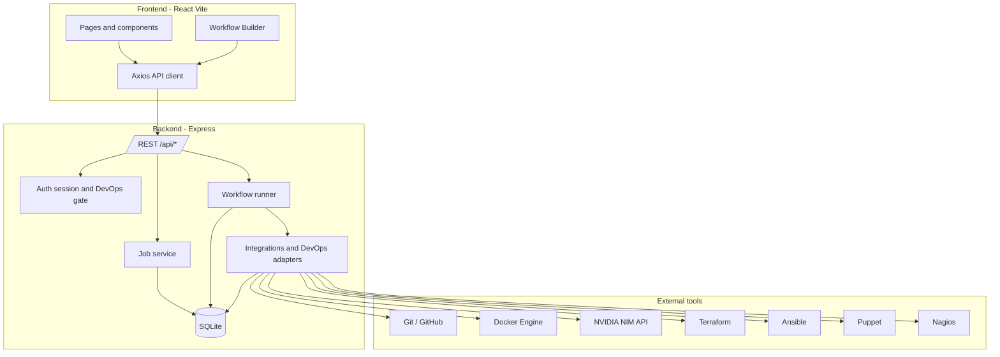
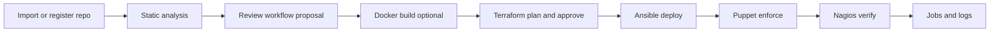

# CódigoFlow

### From Code to Cloud, Simplified.

An **AI-powered developer productivity and DevOps orchestration platform** that unifies source-code management, containerization, infrastructure automation, configuration management, deployment, and monitoring in one workspace.

CódigoFlow integrates established tools — Git/GitHub, Docker, NVIDIA AI, Terraform, Ansible, Puppet, and Nagios — instead of replacing them. Its value is **coordination**: one UI, one job engine, and approval-gated execution across the path from repository to a monitored application.

[](https://nodejs.org)
[](https://www.typescriptlang.org/)
[](https://react.dev/)
[](https://expressjs.com/)
[](https://vitejs.dev/)
[](#license-and-acknowledgements)

**Repository:** [github.com/singhharshitt/Codigoflow](https://github.com/singhharshitt/Codigoflow)

**Academic context:** INT333 Advanced Configuration Management · Academic Session 2026–27

---

## Table of contents

1. [The problem](#the-problem)
2. [The CódigoFlow solution](#the-códigoflow-solution)
3. [Platform features](#platform-features)
4. [How CódigoFlow works](#how-códigoflow-works)
5. [Illustrative deployment workflow](#illustrative-deployment-workflow)
6. [Technology stack](#technology-stack)
7. [System architecture](#system-architecture)
8. [Project structure](#project-structure)
9. [Prerequisites](#prerequisites)
10. [Installation and local setup](#installation-and-local-setup)
11. [Environment variables](#environment-variables)
12. [API reference (verified)](#api-reference-verified)
13. [Security and safety](#security-and-safety)
14. [Testing and validation](#testing-and-validation)
15. [Limitations and known issues](#limitations-and-known-issues)
16. [Roadmap](#roadmap)
17. [Screenshots and demo](#screenshots-and-demo)
18. [Further documentation](#further-documentation)
19. [Contributing](#contributing)
20. [License and acknowledgements](#license-and-acknowledgements)

---

## The problem

Developers and students often jump between disconnected tools for:

- Source control and GitHub analytics
- Containers and compose files
- Infrastructure provisioning
- Server configuration and releases
- Drift enforcement
- Monitoring and incident signals
- Log triage and troubleshooting

That fragmentation makes the **end-to-end deployment lifecycle** hard to see, approve, and debug — especially when each tool has its own CLI, credentials, and failure modes.

---

## The CódigoFlow solution

CódigoFlow provides a single local-first workspace that:

| Capability | Approach |
|---|---|
| Unified interface | React dashboard for repos, Git, Docker, AI, DevOps tools, workflows, and history |
| Established tools | Adapters invoke Git, Docker, Terraform, Ansible, Puppet, Nagios — not proprietary replacements |
| Visual orchestration | React Flow workflow builder with typed executor nodes |
| Execution visibility | Persisted jobs, job logs, workflow node runs |
| AI assistance | NVIDIA NIM (OpenAI-compatible) for commits, errors, Docker logs, chat, and job diagnosis |
| Safety | Allowlisted process execution, plan-hash integrity, approval gates, loopback + session auth for privileged DevOps |

**Vision vs implementation:** The product vision is full code-to-cloud orchestration. This README documents **what the current codebase actually implements**, what needs external setup (Docker daemon, Linux control node, API keys), and what remains partial or illustrative.

---

## Platform features

Status legend used below:

| Status | Meaning |
|---|---|
| **Implemented** | Available in UI/API and covered by automated tests or verified code paths |
| **Requires setup** | Implemented, but needs credentials, Docker, WSL/SSH, or tool binaries |
| **Partial** | Backend and/or UI present; end-to-end UX or live infra not fully wired |
| **Illustrative** | Supported as a documented workflow; may not be one-click executable against live AWS |

### 1. Repository management

**Status:** Implemented

- Register an existing local Git folder (`POST /api/repositories`)
- Inspect a path before registration (`POST /api/repositories/inspect`)
- Import a **public** GitHub repository by URL (anonymous HTTPS shallow clone into server-managed storage) — `POST /api/repositories/github/preview` and `/github/import`
- Optional custom-path clone (`POST /api/repositories/clone`)
- Static repository analysis (stack, Dockerfile, env **names** only) — `GET /api/repositories/:id/analyze`
- Deploy **proposal** (review-only workflow graph) — `POST /api/repositories/:id/deploy-proposal` (does **not** execute infrastructure)

Private GitHub import requires server-side credentials (`GITHUB_TOKEN` / Git credentials) and is explicitly blocked for anonymous import.

### 2. Git Studio

**Status:** Implemented

Supported via allowlisted `git` commands (`spawn`, `shell: false`):

- Status, branches, commits, diffs
- Stage / unstage
- Commit (with confirmation semantics in the API)
- Push
- Checkout branch

`fetch` is allowlisted at the Git adapter layer; there is **no** first-class pull API/UI. Destructive Git commands outside the allowlist are rejected.

### 3. GitHub integration and Contribution Explorer

**Status:** Implemented (public API; higher rate limits with optional token)

- Repository metadata, commits, contributors, branches (`/api/github/...`)
- Contribution Explorer UI for analytics visualization
- Optional `GITHUB_TOKEN` for authenticated GitHub API rate limits

### 4. Docker Manager

**Status:** Requires setup (Docker daemon)

- Daemon status probe
- List containers and images
- Inspect, logs, start / stop / restart
- Image build (repo-scoped)
- Compose actions: `up` | `down` | `ps`

Requires a running Docker Desktop / Engine reachable by the backend process.

### 5. NVIDIA AI Developer Copilot

**Status:** Requires setup (`NVIDIA_API_KEY` or fallback `AI_API_KEY`)

| Capability | Endpoint |
|---|---|
| Status / connection probe | `GET /api/ai/status`, `/connection` |
| Commit message suggestions | `POST /api/ai/commit-messages` |
| Error explanation | `POST /api/ai/explain-error` |
| Docker log analysis | `POST /api/ai/analyze-docker-logs` (paste logs or `containerId`) |
| Chat / ask | `POST /api/ai/ask`, `/chat` |
| Job failure diagnosis | `POST /api/ai/analyze-job` (uses persisted job + `job_logs`) |

Credentials stay in **server** `.env` only. Never put API keys in `VITE_*` variables.

AI output is advisory. It does **not** get unrestricted shell access and must not bypass DevOps approval gates.

### 6. Terraform infrastructure automation

**Status:** Requires setup (Terraform binary on native Linux, WSL, or SSH control node)

- Project listing under `devops/terraform`
- `fmt`, `init`, `validate`, `plan`
- Saved plan storage with **SHA-256 integrity**
- Explicit plan approval + apply of the approved plan file
- Workspaces and filtered outputs (sensitive values redacted to the client)
- Destroy disabled unless `DEVOPS_TF_DESTROY_ENABLED=true`

Privileged mutations require operator session or Bearer token (see [Security](#security-and-safety)).

### 7. Ansible configuration management

**Status:** Requires setup (Ansible on Linux control node)

- Inventory listing / validation
- Ping and facts
- Playbook validate / check / run (run is approval-gated)
- Roles listing and allowlisted ad-hoc

Playbooks and inventories live under `devops/ansible` (and related lab paths).

### 8. Puppet configuration management

**Status:** Requires setup (Puppet on Linux control node)

- Status, modules, facts
- Manifest validation
- Agent noop / run and apply (approval-gated where mutating)
- Certificate listing and **individual** sign (approval-gated — never auto-sign)
- Drift helpers

Standalone apply tests and master/agent flows must be distinguished in lab docs; certificate signing is never automatic.

### 9. Nagios monitoring

**Status:** Implemented for sample data; live status requires setup

- Parse host/service states from status data
- Soft/hard state labeling
- Allowlisted external commands (acknowledge, comments, downtime) with `approve`
- Plugin listing / run
- Reload/validate gate

When `NAGIOS_STATUS_FILE` is unset, CódigoFlow reads bundled `status.dat.sample` and labels it as **sample / not live** (`isSampleData`).

### 10. Visual Workflow Builder

**Status:** Implemented (executors require tools + auth for mutating nodes)

React Flow canvas with registered node kinds, including:

- Control: `start`, `end`
- Terraform: fmt / init / validate / plan / apply
- Ansible: inventory validate, ping, facts, playbook validate / check / run
- Puppet: status, manifest validate, noop, agent run, apply
- Nagios: status, host/service checks, application verify, downtime

Engine capabilities (verified in tests):

- Graph validation and cycle detection
- Topological execution order
- Per-node persistence (`workflow_node_runs`)
- Skip downstream nodes after critical failure / waiting approval
- Concurrent run guard per workflow
- Destructive steps require `approve: true` in node config

UI supports save, validate, run, **load saved workflows**, and hydration from a **deploy proposal** (review-only; no auto-execution).

Illustrative pipeline:

```text
GitHub repository
       ↓
Static analysis / Docker (as configured)
       ↓
Terraform plan (approve → apply)
       ↓
Ansible deploy
       ↓
Puppet enforce
       ↓
Nagios verify
       ↓
Job / node run report
```

### 11. Execution history and live logs

**Status:** Implemented (HTTP); Socket.IO partial

- Jobs persisted in SQLite (`jobs`, `job_logs`)
- List / get / cancel; `GET /api/jobs/:id/logs`
- Execution History UI loads persisted logs and can request AI diagnosis for failed jobs
- Server emits Socket.IO job events; a client helper exists (`client/src/services/socket.ts`) but the history UI currently uses **HTTP**, not a live socket subscription

### 12. Settings, lab, and integrations

**Status:** Implemented

- Settings / integration status views
- DevOps Control Center overview with **Operator session** login (HttpOnly cookie)
- Lab Environment + pipeline **readiness** assessment (does not claim execution succeeded)
- Help page and deeper guides under `docs/`

---

## How CódigoFlow works

```text
Developer
   ↓
CódigoFlow Frontend (React / Vite)
   ↓
Backend API (Express) + Auth / validation / rate limits
   ↓
Services + Job engine + Workflow runner
   ↓
Integration adapters (Git, GitHub, Docker, NVIDIA AI, DevOps)
   ↓
Execution modes: native | WSL | SSH
   ↓
Tool binaries & infrastructure
   ↓
Persisted jobs / logs / plans / approvals → Dashboard
```

| Layer | Responsibility |
|---|---|
| Frontend | UX, forms, React Flow, charts; cookies for operator session (`withCredentials`) |
| API | REST routes, Zod validation, Helmet/CORS, rate limiting |
| Auth | `DEVOPS_API_TOKEN` → login → HttpOnly `cf_session`; Bearer for CLI; loopback by default |
| Jobs | Track long-running operations and append redacted logs |
| Workflow engine | Validate graph, execute node executors, persist node runs |
| DevOps adapters | Safe argv arrays, path allowlists, WSL path bridge, SSH with host-key checking |
| SQLite | Repositories, jobs, workflows, terraform plans, approvals |

---

## Illustrative deployment workflow

The following sequence shows how CódigoFlow is **intended** to support deploying a Node.js app toward AWS EC2. Treat it as an **illustrative lifecycle**. Live AWS apply requires a configured Linux control node, credentials/IAM role, and explicit approvals — it is **not** automatic in this repository.

1. Import a public GitHub repository (or register a local path).
2. Run **Analyse** to detect stack / Dockerfile / env names (no script execution).
3. **Propose** a review-only workflow; open it in the Workflow Builder.
4. Build with Docker when a Dockerfile and daemon are available.
5. Terraform: fmt → init → validate → plan → approve → apply saved plan.
6. Ansible: validate inventory / check / approved playbook run.
7. Puppet: noop → approved apply; certificate sign only when explicitly approved.
8. Nagios: verify status (configure `NAGIOS_STATUS_FILE` for live data).
9. Inspect Execution History logs; optionally AI-diagnose failures.

---

## Technology stack

Verified from `package.json` workspaces and source:

| Category | Technologies |
|---|---|
| Frontend | React 18, Vite 5, TypeScript, Tailwind CSS 3, React Router 6, Zustand, Recharts, Lucide, Axios, Sonner, `@xyflow/react` |
| Backend | Node.js 18+, Express 4, TypeScript, Zod, Pino, Helmet, CORS, compression, express-rate-limit, Socket.IO |
| Database | SQLite via Node.js `node:sqlite` (`DatabaseSync`) with SQL migrations |
| AI | OpenAI SDK against NVIDIA NIM / OpenAI-compatible APIs |
| Source control | Git CLI (allowlisted), GitHub REST API |
| Containers | Docker CLI / Compose via backend integration |
| IaC / CM / monitoring | Terraform, Ansible, Puppet, Nagios (via DevOps adapters + `devops/` assets) |
| Real-time | Socket.IO (server); client helper present |
| Testing | Jest + Supertest (server); ESLint + `tsc` (client/server) |

---

## System architecture





---

## Project structure

Generated from the repository (excluding `node_modules`, build outputs, `.git`, and local data):

```text
Codigoflow/
├── client/                 # React + Vite dashboard
│   ├── public/
│   └── src/
│       ├── components/     # UI shell, shared, DevOps panels
│       ├── features/       # Feature modules (e.g. repositories, workflows)
│       ├── pages/          # Route pages including devops/*
│       ├── services/       # HTTP, auth, DevOps, socket helper
│       └── stores/         # Zustand stores
├── server/                 # Express API
│   └── src/
│       ├── auth/           # HttpOnly session tokens
│       ├── config/         # Env and constants
│       ├── database/       # SQLite + migrations
│       ├── devops/         # Adapters, workflow engine, preflight
│       ├── integrations/   # git, github, docker, ai, terraform, ansible, puppet, nagios
│       ├── jobs/           # Job engine and logs
│       ├── middleware/     # Errors, logging, DevOps auth
│       ├── routes/         # HTTP routers
│       └── services/       # Repository, GitHub import, analysis
├── devops/                 # Lab assets for TF / Ansible / Puppet / Nagios
├── docs/                   # Architecture, setup, security, guides
├── package.json            # npm workspaces root
└── README.md
```

---

## Prerequisites

| Requirement | Notes |
|---|---|
| **Node.js 18+** / **npm 9+** | Required (`engines` in root `package.json`) |
| **Git** | Required for clone/import and Git Studio |
| **Docker Desktop / Engine** | Optional; needed for Docker Manager |
| **NVIDIA API key** (or OpenAI-compatible key) | Optional; needed for AI Copilot |
| **GitHub token** | Optional; raises API rate limits |
| **WSL2 Ubuntu, Linux VM, or SSH control node** | Required for real Terraform / Ansible / Puppet / Nagios binaries on a typical Windows 11 host |
| **AWS credentials / IAM instance role** | Only for live AWS Terraform workflows — not required for local app development |

**Windows 11 honesty:** Node, Git, and the CódigoFlow app run natively. Ansible, Puppet, and Nagios generally need Linux. Prefer `DEVOPS_EXECUTION_MODE=wsl` or `ssh`. Do not assume all DevOps tools execute natively on Windows.

---

## Installation and local setup

Commands below match root and workspace `package.json` scripts.

### 1. Clone

```powershell
git clone https://github.com/singhharshitt/Codigoflow.git
cd Codigoflow
```

### 2. Install dependencies (workspaces)

```powershell
npm install
```

### 3. Configure the backend

```powershell
Copy-Item server\.env.example server\.env
# Edit server\.env — set keys you need; never commit secrets
```

### 4. Configure the frontend (optional)

```powershell
Copy-Item client\.env.example client\.env
# Default: VITE_API_BASE_URL=http://localhost:4000/api
```

### 5. Database

SQLite is created/migrated automatically on server start (`DATABASE_PATH`, default `./data/codigoflow.db`).

Optional explicit init:

```powershell
npm run db:init --workspace=@codigoflow/server
```

### 6. Start development

```powershell
npm run dev
```

- Frontend: [http://localhost:5173](http://localhost:5173)
- Backend: [http://127.0.0.1:4000](http://127.0.0.1:4000)

Or separately:

```powershell
npm run dev:server
npm run dev:client
```

### 7. Verify health

```powershell
curl http://127.0.0.1:4000/api/health
```

Expect `success: true` and integration probes for AI / GitHub / Docker (configured vs available flags — keys are never returned).

### 8. Operator session (privileged DevOps)

1. Set `DEVOPS_API_TOKEN` in `server/.env`.
2. Open **DevOps Control Center → Operator session**.
3. Paste the token once; the server sets HttpOnly cookie `cf_session`.

Do **not** put this token in any `VITE_*` variable.

---

## Environment variables

### Backend (`server/.env`)

| Variable | Purpose | Required | Example |
|---|---|---|---|
| `PORT` | API port | No | `4000` |
| `HOST` | Bind address | No | `127.0.0.1` |
| `NODE_ENV` | Runtime mode | No | `development` |
| `CLIENT_ORIGIN` | CORS / cookie Origin allowlist | No | `http://localhost:5173` |
| `DATABASE_PATH` | SQLite file | No | `./data/codigoflow.db` |
| `LOG_LEVEL` | Pino level | No | `info` |
| `NVIDIA_API_KEY` | Preferred AI key | No* | *(secret)* |
| `NVIDIA_BASE_URL` | AI base URL | No | `https://integrate.api.nvidia.com/v1` |
| `NVIDIA_MODEL` | Model id | No | `qwen/qwen2.5-coder-32b-instruct` |
| `NVIDIA_MAX_TOKENS` | Max tokens | No | `2048` |
| `NVIDIA_TEMPERATURE` | Temperature | No | `0.3` |
| `AI_API_KEY` | Fallback key if NVIDIA unset | No* | *(secret)* |
| `AI_BASE_URL` / `AI_MODEL` | Fallback provider settings | No | — |
| `GITHUB_TOKEN` | GitHub API auth | No | *(secret)* |
| `DEVOPS_EXECUTION_MODE` | `auto` \| `wsl` \| `ssh` \| `native` | No | `auto` |
| `DEVOPS_WSL_DISTRO` | WSL distro name | No | `Ubuntu` |
| `DEVOPS_SSH_HOST` / `USER` / `PORT` / `KEY_PATH` | SSH control node | No | — |
| `DEVOPS_SSH_STRICT_HOST_KEY` | Host key checking | No | `yes` |
| `DEVOPS_ROOT` | DevOps assets root | No | `../devops` |
| `NAGIOS_STATUS_FILE` | Live status.dat path | No | — |
| `NAGIOS_COMMAND_FILE` / `NAGIOS_CFG` | Nagios command/config paths | No | — |
| `DEVOPS_TF_DESTROY_ENABLED` | Allow destroy path | No | `false` |
| `DEVOPS_API_TOKEN` | Operator token (server-only) | Recommended | *(secret)* |
| `SESSION_SECRET` | Cookie HMAC secret | No | defaults to token |
| `DEVOPS_REQUIRE_LOOPBACK` | Restrict privileged ops to loopback | No | `true` |
| `DEVOPS_ENFORCE_TOKEN` | Force token even in dev | No | `false` |
| `REPOS_STORAGE_ROOT` | Managed clone directory | No | `./data/repos` |
| `GITHUB_IMPORT_MAX_MB` | Import size cap | No | `500` |

\*Required only if you use AI features.

### Frontend (`client/.env`)

| Variable | Purpose | Required | Example |
|---|---|---|---|
| `VITE_API_BASE_URL` | API base URL | No | `http://localhost:4000/api` |

No privileged secrets belong in the Vite bundle.

---

## API reference (verified)

Base path: `/api`. Successful responses typically use `{ "success": true, "data": ... }`.

### Health and auth

| Method | Route | Purpose | Auth |
|---|---|---|---|
| GET | `/health` | Liveness + integration probes | None |
| GET | `/auth/status` | Session / auth mode | Cookie optional |
| POST | `/auth/login` | Body `{ "token" }` → HttpOnly session | Rate-limited |
| POST | `/auth/logout` | Clear session | Origin-checked |

### Repositories and Git

| Method | Route | Purpose |
|---|---|---|
| GET/POST | `/repositories` | List / register local path |
| POST | `/repositories/clone` | Clone remote to destination + register |
| POST | `/repositories/inspect` | Validate local path |
| POST | `/repositories/github/preview` | Public/private metadata preview |
| POST | `/repositories/github/import` | Managed public import |
| GET | `/repositories/:id` | Get registration |
| DELETE | `/repositories/:id` | Unregister (files kept) |
| GET | `/repositories/:id/analyze` | Static analysis |
| POST | `/repositories/:id/deploy-proposal` | Analysis + review workflow |
| GET | `/repositories/:id/status\|branches\|commits\|diff` | Git reads |
| POST | `/repositories/:id/stage\|unstage\|commit\|push\|checkout` | Git writes |

### GitHub analytics

| Method | Route | Purpose |
|---|---|---|
| GET | `/github/status` | Token configured? |
| GET | `/github/repositories?url=` | Metadata by URL |
| GET | `/github/repositories/:owner/:repo` | Metadata |
| GET | `/github/repositories/:owner/:repo/commits\|contributors\|branches` | Analytics |

### AI

| Method | Route | Purpose |
|---|---|---|
| GET | `/ai/status`, `/ai/connection` | Config / probe |
| POST | `/ai/commit-messages` | Diff → messages |
| POST | `/ai/explain-error` | Error text |
| POST | `/ai/analyze-docker-logs` | Logs or `containerId` |
| POST | `/ai/ask`, `/ai/chat` | Assistant |
| POST | `/ai/analyze-job` | `{ "jobId" }` grounded diagnosis |

### Docker

| Method | Route | Purpose |
|---|---|---|
| GET | `/docker/status\|containers\|images` | Reads |
| GET | `/docker/containers/:id`, `/logs` | Inspect / logs |
| POST | `/docker/containers/:id/start\|stop\|restart` | Lifecycle |
| POST | `/docker/build`, `/docker/compose` | Build / compose |

### Jobs and workflows

| Method | Route | Purpose | Auth |
|---|---|---|---|
| GET | `/jobs`, `/jobs/:id`, `/jobs/:id/logs` | History | None |
| POST | `/jobs/:id/cancel` | Cancel | None |
| GET | `/history` | Alias of job history | None |
| GET/POST | `/workflows` | List / create | None |
| GET/PUT/DELETE | `/workflows/:id` | CRUD | None |
| POST | `/workflows/:id/validate` | Validate graph | None |
| POST | `/workflows/:id/run` | Execute | **DevOps auth** |
| GET | `/workflows/:id/runs/:jobId/nodes` | Node runs | None |

### DevOps (prefix `/devops`)

| Area | Examples | Auth on mutations |
|---|---|---|
| Hub | `/status`, `/preflight`, `/pipeline` | GET open |
| Terraform | `/terraform/fmt\|init\|validate\|plan\|apply`, plans, workspaces, outputs | Mutations gated |
| Ansible | inventory, ping, facts, playbooks, ad-hoc | Mutations gated |
| Puppet | status, certs/sign, apply, noop, drift, modules | Mutations gated |
| Nagios | status, hosts, services, acknowledge, downtime, reload, plugins | Mutations gated |
| Lab | `/lab/status`, `/lab/pipeline` | GET |

Mutations use `requireDevOpsMutationAuth` (loopback + session cookie or Bearer).

### Integrations

| Method | Route | Purpose |
|---|---|---|
| GET | `/integrations/status` | Aggregated integration states |

For deeper request/response shapes see `docs/api-reference.md` and `docs/api.md`.

---

## Security and safety

Implemented safeguards (verified in code/tests):

- Secrets and `DEVOPS_API_TOKEN` only on the server
- HttpOnly `SameSite=Strict` session cookie; Origin check for cookie-authenticated mutations
- Loopback restriction for privileged DevOps by default (`HOST=127.0.0.1`)
- Rate limiting on `/api` and stricter limit on `/api/auth/login`
- Git/Docker/DevOps: fixed executables, argument arrays, `shell: false`
- Terraform plan hash checked on approve/apply; concurrent apply lock
- Log redaction heuristics for common secret patterns
- Nagios sample data explicitly labeled non-live
- SSH adapter defaults to strict host-key checking
- Import: URL validation, size limits, failed-clone cleanup; no execution of imported scripts during import/analysis

**Remaining limitations:** keep the API on localhost until production authz is hardened for remote exposure; real AWS access depends on control-node IAM/credentials outside the browser; Socket.IO rooms are not fully consumed by the history UI.

---

## Testing and validation

### Commands

```powershell
# Server unit + integration tests
npm run test

# TypeScript
npm run typecheck

# ESLint (client + server)
npm run lint

# Production builds
npm run build
```

Workspace-specific:

```powershell
npm run test --workspace=@codigoflow/server
npm run typecheck --workspace=@codigoflow/client
npm run lint --workspace=@codigoflow/client
```

### Latest verification (this documentation pass)

| Check | Result |
|---|---|
| Server Jest | **18 suites, 68 tests passed** |
| Root `npm run typecheck` | **passed** (client + server) |

Automated coverage includes Git safety, AI status (no key leakage), DevOps auth (Bearer + session), workflow engine, Terraform/Ansible/Puppet/Nagios unit surfaces, GitHub import preview, secret-exposure guard (no `VITE_DEVOPS_API_TOKEN`), and pipeline readiness.

Live AWS / WSL tool installation / Vagrant labs are **not** claimed as green by these tests.

---

## Limitations and known issues

- DevOps tool binaries usually require WSL2/SSH Linux; Windows-native execution is limited.
- Docker features need a running daemon.
- AI features need a configured API key.
- Public GitHub import only without credentials; private repos need explicit auth setup.
- Nagios defaults to **sample** status unless `NAGIOS_STATUS_FILE` is set.
- Workflow mutating nodes need operator auth and real tools; proposals are review-only.
- Execution History prefers persisted HTTP logs; live Socket.IO UI subscription is incomplete.
- No LICENSE file is present in the repository at documentation time.
- No checked-in product screenshots or public demo URL.

---

## Roadmap

### Completed (in codebase)

- Repository register / inspect / public GitHub import
- Git Studio allowlisted operations
- Docker manager API + UI
- NVIDIA-oriented AI Copilot + job log diagnosis
- Terraform / Ansible / Puppet / Nagios control surfaces + workflow executors
- Operator session auth (no Vite privilege token)
- Static analysis + deploy proposal
- Product and engineering audit docs

### In progress / partial

- Full guided one-click remote deploy against live AWS
- Inventory generation from verified Terraform outputs
- Socket.IO-driven live log UI
- Broader log retention / history filters

### Planned

- Richer AI-generated workflows (always human-reviewed)
- Additional cloud providers beyond current `devops/terraform` sketches
- Deployment rollback helpers
- Team RBAC beyond single operator token
- Hardened remote exposure model for non-loopback hosts

---

## Screenshots and demo

No screenshot assets or hosted demo URL are currently checked into this repository (`client/public` contains `favicon.svg` only).

When adding screenshots, place them under a dedicated folder (for example `docs/images/`) and link with relative paths.

---

## Further documentation

| Document | Topic |
|---|---|
| [`docs/codigoflow-product-audit.md`](docs/codigoflow-product-audit.md) | Product/feature matrix |
| [`docs/final-engineering-audit.md`](docs/final-engineering-audit.md) | Engineering audit |
| [`docs/architecture.md`](docs/architecture.md) / [`docs/backend-architecture.md`](docs/backend-architecture.md) | Architecture |
| [`docs/development-setup.md`](docs/development-setup.md) | Local setup |
| [`docs/lab-setup.md`](docs/lab-setup.md) | WSL/lab control node |
| [`docs/devops-architecture.md`](docs/devops-architecture.md) | DevOps adapters |
| [`docs/terraform-guide.md`](docs/terraform-guide.md) | Terraform |
| [`docs/ansible-guide.md`](docs/ansible-guide.md) | Ansible |
| [`docs/puppet-guide.md`](docs/puppet-guide.md) | Puppet |
| [`docs/nagios-guide.md`](docs/nagios-guide.md) | Nagios |
| [`docs/nvidia-ai-setup.md`](docs/nvidia-ai-setup.md) | AI keys |
| [`docs/devops-security-audit.md`](docs/devops-security-audit.md) | Security notes |
| [`docs/api-reference.md`](docs/api-reference.md) | Extended API notes |

---

## Contributing

1. Fork the repository and create a feature branch from an up-to-date base.
2. Prefer small, additive changes; do not rewrite working modules without cause.
3. Keep secrets out of Git (`.env`, keys, Terraform state, private keys).
4. Run `npm run test`, `npm run typecheck`, and `npm run lint` before opening a PR.
5. Describe what was verified (and what was not — e.g. live AWS).

---

## License and acknowledgements

**License:** No `LICENSE` file is present in this repository. Rights and redistribution terms are therefore **unspecified** until a license is added by the maintainers.

**Acknowledgements:** Built with Node.js, React, Express, Vite, Tailwind CSS, Zustand, React Flow, Zod, Socket.IO, the OpenAI SDK (NVIDIA NIM–compatible), Git, Docker, Terraform, Ansible, Puppet, Nagios, and the wider open-source ecosystem those projects depend on.

---

*CódigoFlow — From Code to Cloud, Simplified.*
